  

# 🛒 Awesome Merchant of Record (MoR) 

> A curated directory of top **Merchant of Record (MoR)** SaaS platforms, payment infrastructure, and open-source MoR alternatives for software creators, digital goods, and SaaS founders. 🚀

  
  
  
  
  

---

## 💡 What is a Merchant of Record (MoR)?

A **Merchant of Record (MoR)** is the legal entity authorized and held liable by financial institutions and governments to process a customer's credit or debit card transaction and act as the legal seller of software, SaaS, or digital goods.

Unlike standard payment gateways (such as Stripe, PayPal, or Adyen) where the vendor remains legally responsible for global tax remittance, consumer compliance, and financial liability, a **Merchant of Record handles:**
- 🌍 **Global Indirect Tax Compliance**: Automatic calculation, collection, and filing of Sales Tax, VAT, and GST across 140+ countries and state jurisdictions.
- 🛡️ **Financial & Regulatory Liability**: Full chargeback administration, fraud prevention guarantees, PCI-DSS compliance, and foreign exchange exposure.
- 💳 **Localized Global Checkout**: Supporting 30+ regional currencies and hyper-local payment rails (e.g., Pix, iDEAL, SEPA, UPI, Alipay).
- 🧾 **Invoicing & Digital Receipts**: Issuing audit-proof B2B and B2C tax invoices in accordance with local regulations.

---

## 📈 Sector Overview & Market Dynamics

The global market for Merchant of Record (MoR) and digital cross-border tax compliance services is estimated between **$4.8 billion and $12.6 billion in 2025–2026**, projected to surge past **$25 billion to $38+ billion by 2032** at a Compound Annual Growth Rate (CAGR) of approximately **12% to 14.8%**. 📊

The sector displays a **moderately fragmented and evolving structure**: while enterprise cross-border commerce and underlying merchant acquiring remain concentrated around a handful of multi-billion dollar payment leaders and public players (such as Shopify Managed Markets and Global-e), the SaaS, indie developer, and creator monetization layer features diverse, specialized competition (including Lemon Squeezy, Paddle, FastSpring, PayPro Global, and Polar). As global digital tax enforcement tightens worldwide, pure-play MoRs continue to experience strong secular tailwinds.

---

## 📑 Table of Contents

- [📈 Sector Overview & Market Dynamics](#-sector-overview--market-dynamics)
- [🏢 SaaS Merchant of Record Platforms](#-saas-merchant-of-record-platforms)
- [💻 Open-Source MoR & Billing Infrastructure](#-open-source-mor--billing-infrastructure)
- [⚖️ MoR vs Traditional Payment Gateway Comparison](#️-mor-vs-traditional-payment-gateway-comparison)
- [🧭 How to Choose an MoR](#-how-to-choose-an-mor)
- [🤝 How to Contribute](#-how-to-contribute)
- [💖 Support](#-support)
- [⭐ Star History](#-star-history)
- [⚠️ Disclaimer & Tax Liability Notice](#️-disclaimer--tax-liability-notice)

---

## 🏢 SaaS Merchant of Record Platforms

*Sorted by company scale (valuation / annual revenue, descending).*

| Platform | Valuation / Revenue | Starting Pricing Tier | Free Tier / Trial Limit | Key Focus & Specialties |
| :--- | :--- | :--- | :--- | :--- |
| **[Shopify Markets Pro](https://www.shopify.com/markets)** 🛍️ | **~$100B+ Market Cap** (Shopify Inc. NYSE: SHOP; ~$7B+ rev) | **3.5% + domestic processing fee** for Basic/Grow/Advanced plans (3.25% on Shopify Plus) + 1.5%–2% FX fee | **3-day free trial** + promotional $1/month for first month; requires an active Shopify merchant subscription | Cross-border physical and digital commerce; handles international customs, duties, global tax remittance, and DHL Express shipping across 150+ countries. |
| **[Global-e](https://www.global-e.com/)** 🌐 | **~$6.95B Market Cap** (NASDAQ: GLBE; ~$1.11B TTM rev) | **Custom % commission fee** based on international GMV tiers (typically 4.5%–6.5% + transaction fees) | **No self-serve free trial**; requires enterprise demo and custom qualification evaluation | End-to-end enterprise cross-border MoR for major multi-brand DTC retailers; handles localization, duty calculation, local returns, and 100+ local currencies. |
| **[2Checkout (Verifone)](https://www.2checkout.com/)** 💳 | **~$3.4B Acquisition Valuation** by Francisco Partners / Verifone | **6.0% + $0.60** per sale on 2Monetize (MoR tier); (2Sell gateway starts at 3.5% + $0.35) | **No self-serve free plan**; test sandbox environment provided; supports configuring up to **30-day free trials** for end customer subscriptions | Global digital goods, downloadable software, and software licenses; automatic VAT compliance across 200+ countries with built-in affiliate network. |
| **[Paddle](https://www.paddle.com/)** 🏓 | **~$1.4B Valuation** ($200M Series D; ~$60M+ ARR) | **5% + $0.50** per successful checkout transaction on standard pay-as-you-go | **Free forever account signup** with zero monthly maintenance fee; test sandbox included; full developer API access until first live sale | MoR designed specifically for B2B and B2C SaaS; includes subscription billing, dunning management, tax collection, and ProfitWell revenue metrics. |
| **[Lemon Squeezy](https://www.lemonsqueezy.com/)** 🍋 | **Acquired by Stripe (2024)** (~$20M+ est. valuation / $5M–$10M ARR) | **5% + $0.50** per successful transaction (+1.5% for international cards, +0.5% for recurring subscriptions) | **Free forever account** ($0/month subscription); access to full checkout features; free email marketing up to **500 subscribers** | Developer-first MoR for indie hackers, SaaS products, digital downloads, and software license keys; sleek hosted checkout and customer portal. |
| **[FastSpring](https://fastspring.com/)** ⚡ | **~$400M–$500M Est. Valuation** (Accel-KKR backed; ~$50M+ ARR) | **8.9% flat rate** per transaction (or volume-based custom starting at 5.9% + $0.95) | **14-day full-featured sandbox/free trial** with test transactions; no upfront credit card required | Enterprise software and SaaS platform with popup and embedded checkouts, localized billing, and interactive quoting for B2B deals. |
| **[Nexway](https://www.nexway.com/)** 🕹️ | **~$40M Annual Revenue** (€200M+ processed GMV) | **Custom % revenue share** (volume-based quote, typically 5.5%–8% for digital publishers) | **No free tier**; custom sandbox and assisted onboarding provided via sales consultation | Digital video games, software distribution, and publisher monetization with global fraud management and regional checkout pages. |
| **[Cleverbridge](https://www.cleverbridge.com/)** 🌉 | **~$35M–$42M Annual Revenue** ($10B+ cumulative processed GMV) | **Custom % revenue share** per transaction based on projected annual gross merchandise value (GMV) | **No self-serve free trial**; sandbox environment provisioned upon enterprise sales consultation and contract review | Mid-market and enterprise B2B SaaS and consumer software; customer renewal engine, dunning management, and compliance across 240+ countries. |
| **[PayPro Global](https://www.payproglobal.com/)** 🌍 | **~$9.4M Annual Revenue** (Bootstrapped profitable category provider) | **4.9% + $1.00** per transaction (or 7.9% flat depending on risk profile and product type) | **No recurring monthly fees**; free developer account and testing environment available before contract signing | Software, SaaS, and digital goods MoR with 24/7 localized customer purchase support, fraud detection, and multi-currency billing. |
| **[MerchantSpring](https://www.merchantspring.com/)** 📊 | **~$3M–$5M Est. Revenue** (Fast-growing e-commerce tooling provider) | **$31/month** (Brand entry plan, billed annually) up to $399+/month for multi-store agencies | **14-day free trial** with full access to connect up to 5 marketplace stores; no credit card required | Multi-channel marketplace analytics, store management, and unified fee/tax reconciliation across Amazon, Shopify, and Walmart. |

---

## 💻 Open-Source MoR & Billing Infrastructure

*Sorted by GitHub Stargazers count (descending).*

| Project | GitHub_Stars | License | Tech Stack | Architecture & Description |
| :--- | :---: | :---: | :---: | :--- |
| **[Juspay / Hyperswitch](https://github.com/juspay/hyperswitch)** ⚡ |  | Apache-2.0 | Rust 🦀 | High-performance open-source payments switch and routing orchestration platform connecting 50+ payment gateways, smart fraud routing, and global payout channels. |
| **[Lago](https://github.com/getlago/lago)** 🌊 |  | AGPL-3.0 | Ruby 💎 / Go 🐹 | Open-source metering and usage-based subscription billing engine; coordinates hybrid pricing models, credit wallets, invoicing, and tax integrations. |
| **[Polar](https://github.com/polarsource/polar)** 🐻‍❄️ |  | Apache-2.0 | Python 🐍 (FastAPI) / Next.js ⚛️ | **The leading open-source MoR platform**. Manages customer accounts, sales tax, EU VAT remittance, digital product downloads, SaaS subscriptions, and GitHub/Discord benefit granting. |
| **[Kill Bill](https://github.com/killbill/killbill)** 🗡️ |  | Apache-2.0 | Java ☕ | Mature, enterprise-grade open-source subscription billing and payments engine with plugin architecture for payment gateways, tax calculation engines, and invoice generation. |
| **[OpenMeter](https://github.com/openmeterio/openmeter)** ⏱️ |  | Apache-2.0 | Go 🐹 | Real-time usage-based metering and billing infrastructure for AI agents, APIs, and cloud services; processes high-throughput token and event streams for revenue tracking. |
| **[Tier](https://github.com/tierrun/tier)** 🎯 |  | BSD-3-Clause | Go 🐹 | Lightweight pricing and metering engine that synchronizes pricing models, tiers, and SaaS features directly with Stripe billing. |
| **[Creem SDKs](https://github.com/armitage-labs/creem)** 🍦 |  | MIT | TypeScript 🟦 | Open-source developer SDKs, authentication bridges (Better-Auth, Next.js, Convex), and MCP (Model Context Protocol) server for Creem's MoR billing services. |
| **[Blooms](https://github.com/im-Kazmi/Blooms-)** 🌸 |  | MIT | Hono.js 🔥 / Next.js ⚛️ / Prisma 🗄️ | Open-source self-hosted Lemon Squeezy and Paddle alternative prototype; digital checkout, license key issuance, and multi-currency billing over Stripe. |
| **[Payment Platform for Marketplaces](https://github.com/dcaglar/payment-platform-for-marketplaces)** 🏗️ |  | MIT | TypeScript 🟦 / Node.js 🟩 | Reference architecture demonstrating merchant of record payment flow orchestration, sub-merchant onboarding, ledgering, and marketplace payout handling. |
| **[Starfish](https://github.com/makestarfish/starfish)** ⭐ |  | Apache-2.0 | Rust 🦀 | Minimalist open-source Merchant of Record service written in Rust for developers building lightweight sovereign software checkout pipelines. |

---

## ⚖️ MoR vs Traditional Payment Gateway Comparison

| Feature / Responsibility | Traditional Payment Gateway (e.g. Stripe, Braintree) | Merchant of Record (e.g. Paddle, Polar, Lemon Squeezy) |
| :--- | :---: | :---: |
| **Legal Seller on Invoice** | Your Company | The MoR Provider |
| **Global Sales Tax / VAT Filing** | ❌ Merchant must register & file in every jurisdiction | ✅ Fully automated and filed under MoR's corporate entities |
| **Chargeback Liability & Defense** | ❌ Merchant absorbs fee + loss | ✅ MoR absorbs or handles automated dispute representation |
| **Foreign Exchange (FX) Conversion** | ❌ Merchant bears currency fluctuation risk | ✅ Handled at checkout across 30+ native currencies |
| **PCI-DSS Compliance Scope** | Partial (SAQ-A or higher required) | Minimal (hosted under MoR umbrella) |
| **Local Payment Methods** | Manual activation per country | Native pre-configured checkout rails |
| **Typical Transaction Cost** | 2.9% + $0.30 + tax tooling fees | 4.0% – 5.5% + $0.40–$0.50 (all compliance included) |

---

## 🧭 How to Choose an MoR

When evaluating whether to adopt a commercial MoR or an open-source engine:

1. 🌐 **Transaction Velocity & Geography**: If more than 30% of your buyers reside across the EU, UK, Canada, Australia, and multiple US states, economic nexus thresholds make manual indirect tax filings prohibitively expensive. An MoR pays for itself in compliance accounting savings.
2. 📦 **Product Type**: For digital assets, software licenses, or subscription SaaS, tools like **Paddle**, **Lemon Squeezy**, or **Polar** provide out-of-the-box key generation, customer billing portals, and dunning workflows.
3. 🛠️ **Open-Source Self-Hosting Considerations**: While platforms like **Polar** open-source their billing engines and digital checkout logic, acting as an MoR requires registering tax entities with regulatory bodies worldwide. Software alone cannot replace banking and legal jurisdictions.

---

## 🤝 How to Contribute

Contributions, updates, and corrections are always welcome! 🙌

1. 🍴 Fork this repository.
2. 🌿 Create a feature branch (`git checkout -b feat/add-mor-tool`).
3. 📝 Add or update entries with factual pricing, free tier information, and proper links.
4. 🚀 Open a descriptive Pull Request.

Please review existing tables to keep descriptions clear, concise, and non-promotional.

---

## 💖 Support

If you found this list helpful, please consider showing your support:

- ⭐ **Star** this repository to make it easier for other creators and developers to discover.
- 🍴 **Fork** and contribute tools, updates, or benchmarks.
- 📢 **Share** with founders, SaaS builders, and payment engineers.
- ☕ **Buy me a coffee**: Support ongoing curation and maintenance via the [Sponsor Dashboard](https://github.com/sponsors/ishandutta2007). Thank you for being a part of the open-source community!

---

##  Star History

---

## ⚠️ Disclaimer & Tax Liability Notice

*This repository is a community-curated educational and developer resource. It does not constitute legal, financial, or tax advice. Merchant of Record status involves formal legal reseller liability, bank sponsorship, and local indirect tax filings. Consult a licensed tax advisor or legal counsel when architecting cross-border payment operations.*
